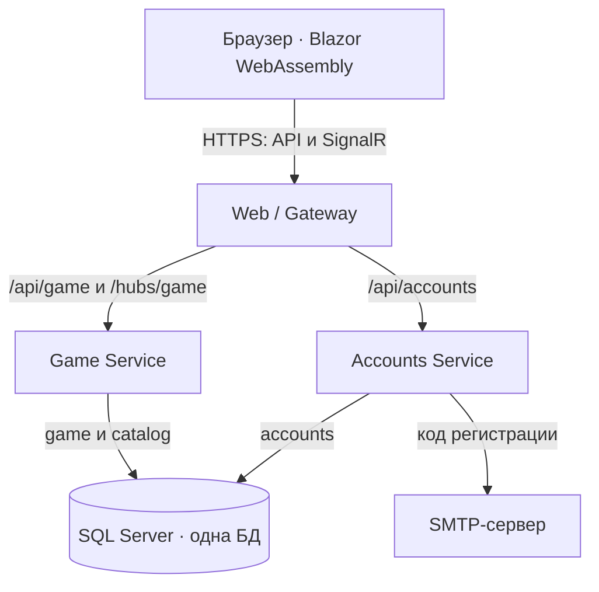
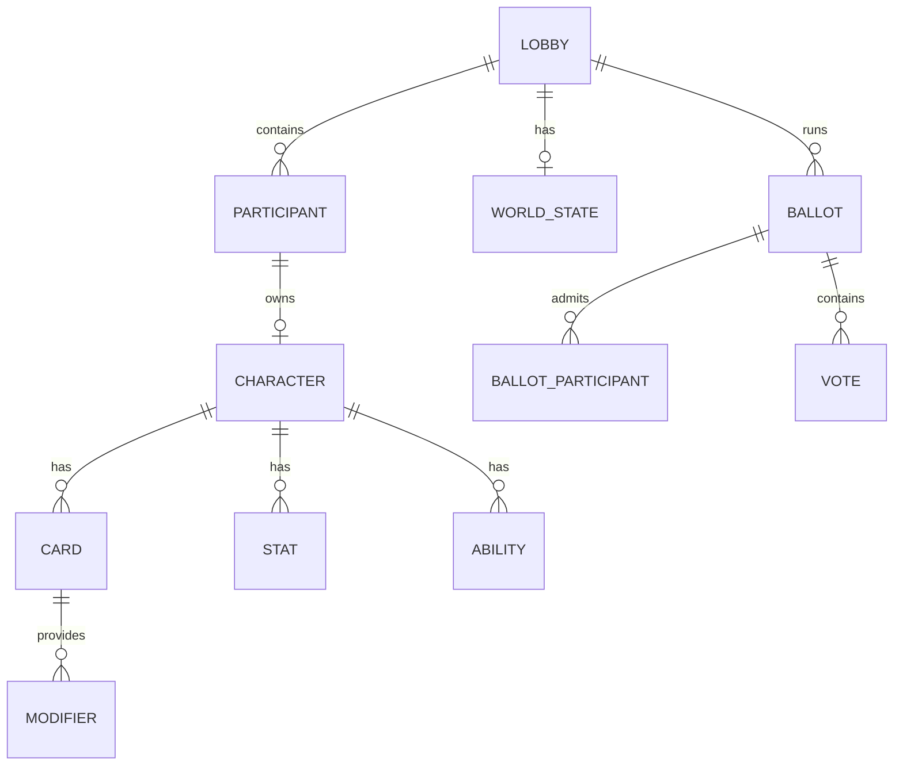
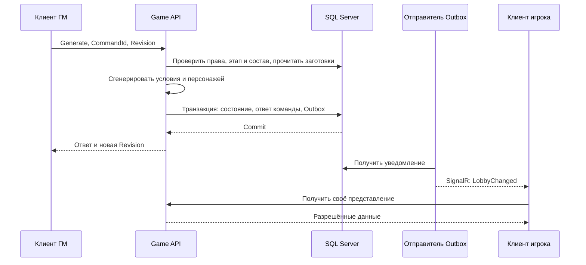
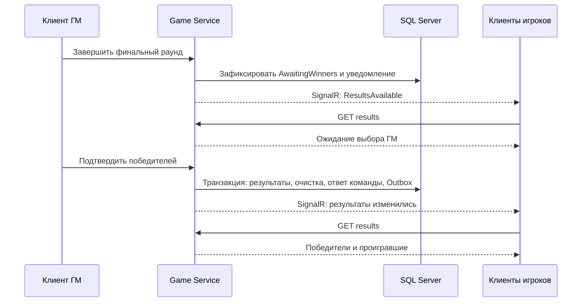

# Архитектура Bunkers & Bluffs MVP

**Версия:** 0.1  
**Дата:** 04.11.2026  
**Статус:** рабочий черновик  
**Основание:** GDD MVP проекта.

## 1. Цель и контекст

Bunkers & Bluffs — браузерная многопользовательская дискуссионная игра с ролевыми элементами. Игроки пытаются обеспечить выживание своих персонажей при мировой катастрофе. Гейм-мастер (ГМ) ведёт партию, разрешает действия и определяет победителей. Спасение возможно как в бункере, так и за его пределами.

Основная аудитория — **компании друзей**, которым интересны общение, переговоры, блеф и совместное создание игровых историй. Дополнительная аудитория — любители настольных игр на социальное взаимодействие и ролевых игр с ведущим.

Цель архитектуры — определить структуру .NET-проекта, обеспечить согласованность состояния партии и подготовить независимое масштабирование сервисов.

## 2. Требования

### 2.1. Функциональные требования

| Область       | Поведение                                                                                                                       |
| ------------- | ------------------------------------------------------------------------------------------------------------------------------- |
| Аккаунт       | Регистрация с проверкой почты, вход и выход. После регистрации открывается окно входа                                           |
| Лобби         | Создание, подключение по коду на этапе сбора, готовность и выход. Пользователь с действующим участием направляется в своё лобби |
| Роли          | Создатель становится ГМ; подключившийся пользователь — игроком со статусом «Не готов». В партии от 6 до 12 игроков и 1 ГМ       |
| Генерация     | ГМ запускает создание мира, бункера и персонажей; затем может редактировать полученные характеристики                           |
| Основная игра | Раунды: раскрытие характеристик, действия, голосование. ГМ управляет переходами и очередностью ходов                            |
| Механики      | Характеристики и модификаторы, способности, проверки d20, атаки, первая помощь, побег, вылазки и утрата морали по GDD           |
| Финал         | Отдельная страница результатов. ГМ фиксирует победителей, включая пустой список                                                 |
| Профиль       | В хедере и таблицах отображаются никнейм и стандартная картинка-заглушка                                                        |

### 2.2. Целевые показатели производительности

Значения являются целями проектирования. Подтверждение — нагрузочные испытания раздела 8.3.

| Показатель                          | Цель                                                                |
| ----------------------------------- | ------------------------------------------------------------------- |
| Одновременно активные лобби         | 50                                                                  |
| Одновременно подключённые участники | 650: по 12 игроков и 1 ГМ в каждом лобби                            |
| Постоянная нагрузка HTTP API        | 200 RPS                                                             |
| Пиковая нагрузка HTTP API           | 500 RPS в течение 30 секунд                                         |
| Ответ обычного API-запроса          | p95 ≤ 500 мс                                                        |
| Доставка игрового обновления        | p95 ≤ 1 секунды от фиксации в БД до получения подключённым клиентом |
| Генерация партии из 12 игроков      | p95 ≤ 5 секунд                                                      |
| Доля HTTP 5xx                       | ≤ 0,1% в постоянном режиме и на пике, рассчитывается отдельно       |

| Правило измерения | Определение                                                                           |
| ----------------- | ------------------------------------------------------------------------------------- |
| p95               | Не менее 95% измерений укладываются в норматив                                        |
| Ответ API         | От получения запроса Gateway до отправки ответа; генерация и SMTP измеряются отдельно |
| RPS               | Прикладные HTTP-команды и чтение состояния                                            |
| SignalR           | Задержка обновлений при 650 соединениях; обрывы фиксируются отдельно                  |
| Масштаб           | 50 лобби — цель испытаний; максимальное число комнат определяется ресурсами окружения |

## 3. Общая схема

### 3.1. Компоненты

### 3.2. Технологии

| Задача                     | Технология                   |
| -------------------------- | ---------------------------- |
| Платформа                  | C#, .NET 10 LTS              |
| Интерфейс                  | Blazor WebAssembly, HTML/CSS |
| HTTP API                   | ASP.NET Core Web API         |
| Маршрутизация              | YARP                         |
| Обновления клиента         | ASP.NET Core SignalR         |
| Хранение и доступ к данным | SQL Server, EF Core 10       |
| Учётные записи             | ASP.NET Core Identity        |
| Удостоверение пользователя | Подписанные JWT              |
| Почтовый транспорт         | SMTP через адаптер Accounts  |
| Окружение                  | Docker Compose               |

### 3.3. Структура solution

Solution: `BunkersAndBluffs.sln`. Все имена проектов имеют префикс `BunkersAndBluffs.`; в таблице указана оставшаяся часть имени.

| Родительская папка | Проект                      | Содержимое                                                                         |
| ------------------ | --------------------------- | ---------------------------------------------------------------------------------- |
| `src/Web/`         | `Client`                    | Страницы, компоненты, HTTP-клиенты и подключение SignalR                           |
| `src/Web/`         | `Gateway`                   | Выдача клиентских файлов, маршруты YARP и health endpoints                         |
| `src/Accounts/`    | `Accounts.Api`              | Endpoints, аутентификация, регистрация зависимостей                                |
| `src/Accounts/`    | `Accounts.Application`      | Регистрация, подтверждение почты и управление сессиями                             |
| `src/Accounts/`    | `Accounts.Infrastructure`   | Identity, EF Core, SMTP, подпись JWT и миграции                                    |
| `src/Game/`        | `Game.Api`                  | Endpoints, SignalR Hub, регистрация зависимостей                                   |
| `src/Game/`        | `Game.Application`          | Сценарии, транзакции, проверки прав и персональные представления                   |
| `src/Game/`        | `Game.Domain`               | Модель партии, переходы состояний и правила GDD                                    |
| `src/Game/`        | `Game.Infrastructure`       | EF Core, каталог, генератор случайных чисел, доставка уведомлений и фоновые задачи |
| `src/Contracts/`   | `Accounts.Contracts`        | DTO Accounts                                                                       |
| `src/Contracts/`   | `Game.Contracts`            | DTO команд, представлений и уведомлений Game                                       |
| `tests/`           | `Game.Domain.Tests`         | Формулы и переходы состояний                                                       |
| `tests/`           | `Game.IntegrationTests`     | API, SQL, конкурентные команды и доступ к данным                                   |
| `tests/`           | `Accounts.IntegrationTests` | Регистрация, коды и сессии                                                         |

| Связь проектов                    | Правило                                                                              |
| --------------------------------- | ------------------------------------------------------------------------------------ |
| Application → Domain              | Сценарии используют доменную модель Game                                             |
| Infrastructure → Application      | Адаптеры реализуют интерфейсы приложения                                             |
| Api → Application, Infrastructure | API вызывает сценарии и собирает зависимости через DI                                |
| Client → Contracts                | Клиент использует публичные DTO                                                      |
| Accounts ↔ Game                   | Независимые проекты реализации; совместимость определяется контрактом аутентификации |

В корне находятся `compose.yaml` и `.env.example`, архитектурный документ — `docs/ARCHITECTURE.md`. README содержит ссылку на него. Документ обновляется при изменении архитектуры.

## 4. Описание сервисов

### 4.1. Accounts Service

| Аспект             | Решение                                                |
| ------------------ | ------------------------------------------------------ |
| Ответственность    | Аккаунты, подтверждение почты и сессии браузера        |
| Хранилище          | Схема `accounts`, `AccountsDbContext`                  |
| Входящий интерфейс | HTTP API                                               |
| Исходящие данные   | JWT для клиента; проверочное письмо через адаптер SMTP |

Базовый маршрут: `/api/accounts`.

| Метод | Путь                        | Назначение                                        |
| ----- | --------------------------- | ------------------------------------------------- |
| POST  | `/registration/email-code`  | Отправить код регистрации                         |
| POST  | `/registration/verify-code` | Проверить код и подтвердить почту для регистрации |
| POST  | `/register`                 | Создать аккаунт                                   |
| POST  | `/login`                    | Открыть сессию                                    |
| POST  | `/refresh`                  | Обновить доступ                                   |
| POST  | `/logout`                   | Завершить текущую сессию                          |
| GET   | `/me`                       | Получить сведения для состояния входа и хедера    |

### 4.2. Game Service

| Аспект              | Решение                                              |
| ------------------- | ---------------------------------------------------- |
| Ответственность     | Лобби, партии, игровые правила, каталог и результаты |
| Хранилище           | Схемы `game`, `catalog`; `GameDbContext`             |
| Входящий интерфейс  | HTTP-команды и запросы; подписка SignalR             |
| Исходящие сообщения | Клиентские уведомления раздела 6.2                   |

| Модуль       | Ответственность                                                |
| ------------ | -------------------------------------------------------------- |
| `Lobbies`    | Участие, порядок игроков и готовность                          |
| `Generation` | Создание мира, бункера и персонажей                            |
| `Characters` | Характеристики, способности и состояния персонажа              |
| `Rounds`     | Раунды, этапы и ход                                            |
| `Voting`     | Допуск, голоса, подсчёт и исключение из претендентов на бункер |
| `GameMaster` | Редактирование и разрешение действий                           |
| `Results`    | Выбор победителей и хранение итогов                            |
| `Views`      | Персональные представления участников                          |

#### 4.2.1. HTTP API

Базовый маршрут: `/api/game/lobbies`. `{id}` — внутренний идентификатор лобби, отличный от кода подключения.

| Метод  | Путь                                                       | Назначение                                                 |
| ------ | ---------------------------------------------------------- | ---------------------------------------------------------- |
| POST   | `/`                                                        | Создать лобби                                              |
| POST   | `/join`                                                    | Подключиться по коду                                       |
| GET    | `/current`                                                 | Определить текущее участие и адрес страницы                |
| GET    | `/{id}/view`                                               | Получить персональное представление                        |
| PUT    | `/{id}/readiness`                                          | Установить готовность                                      |
| POST   | `/{id}/leave`                                              | Окончательно выйти                                         |
| DELETE | `/{id}`                                                    | Удалить лобби по команде ГМ                                |
| POST   | `/{id}/generate`                                           | Сгенерировать условия                                      |
| POST   | `/{id}/start`                                              | Начать основную игру                                       |
| POST   | `/{id}/phase/advance`                                      | Завершить текущий этап и перейти к следующему              |
| POST   | `/{id}/turn/advance`                                       | Передать ход                                               |
| POST   | `/{id}/characters/{characterId}/reveal`                    | Раскрыть характеристику                                    |
| POST   | `/{id}/characters/{characterId}/abilities/{abilityId}/use` | Использовать способность                                   |
| PATCH  | `/{id}/gm/characteristics`                                 | Изменить характеристики, модификаторы и статус способности |
| POST   | `/{id}/gm/d20`                                             | Выполнить общую проверку                                   |
| POST   | `/{id}/gm/attacks`                                         | Разрешить атаку                                            |
| POST   | `/{id}/gm/sorties`                                         | Разрешить вылазку                                          |
| POST   | `/{id}/gm/sorties/{sortieId}/item-choice`                  | Выбрать предмет для соответствующего исхода вылазки        |
| POST   | `/{id}/gm/escapes`                                         | Разрешить побег                                            |
| PUT    | `/{id}/voting/{ballotId}/vote`                             | Подать голос                                               |
| POST   | `/{id}/gm/voting/reinstate`                                | Вернуть исключённого игрока в претенденты на бункер        |

| Метод | Полный маршрут результатов             | Назначение                         |
| ----- | -------------------------------------- | ---------------------------------- |
| POST  | `/api/game/results/{resultId}/confirm` | ГМ фиксирует победителей           |
| GET   | `/api/game/results/{resultId}`         | Получить ожидание выбора или итоги |

Редактирование принимает типизированные изменения характеристик. Перечень доступных действий зависит от роли, этапа и состояния персонажа.

### 4.3. Web / Gateway и клиент

| Компонент                 | Ответственность                                                                                    |
| ------------------------- | -------------------------------------------------------------------------------------------------- |
| Gateway                   | Выдача файлов клиента, маршруты Accounts/Game/SignalR, проверки доступности                        |
| Client                    | Главная страница, хедер, окна аккаунта, лобби и отдельная страница результатов                     |
| Компоненты лобби          | Информация о лобби, мир, персонаж, панель управления, таблицы игроков и блок ГМ в порядке GDD      |
| Клиентские взаимодействия | Вкладки таблиц, модальные окна, 3D-наклон карточек и отображение подтверждённых сервером изменений |

## 5. Модель данных

### 5.1. Владение и таблицы

В одной физической БД используются отдельные SQL-пользователи и миграции владельцев схем. Связь Accounts с Game — идентификатор `UserId`; каждый сервис обращается к собственным таблицам.

| Таблица Accounts                  | Основные данные                                                                                                   |
| --------------------------------- | ----------------------------------------------------------------------------------------------------------------- |
| `accounts.Users`                  | `UserId`, почта и никнейм с нормализованными значениями, хеш пароля, подтверждение почты, служебные поля Identity |
| `accounts.RegistrationChallenges` | Попытка регистрации, почта, защищённое представление кода, срок, число попыток, проверка и погашение              |
| `accounts.Sessions`               | Пользователь, хеш refresh token, срок действия и отзыв                                                            |

| Таблица Game               | Основные данные                                                                                           |
| -------------------------- | --------------------------------------------------------------------------------------------------------- |
| `game.Lobbies`             | Код, состояние, время создания, число раундов, текущий раунд/этап/ход, `Revision`, `rowversion`           |
| `game.Participants`        | `UserId`, снимок никнейма, роль, порядок, готовность, исключение из претендентов на бункер и время выхода |
| `game.PresenceConnections` | Подключения участника и срок актуальности каждого соединения                                              |
| `game.WorldStates`         | Катастрофа, её длительность, параметры и инвентарь бункера                                                |
| `game.Characters`          | Владелец, состояние сознания, участие, вылазка/побег и сроки по раундам, `DeathDueRound`                  |
| `game.CharacterCards`      | Категория, значение, источник и раскрытие карточки                                                        |
| `game.CharacterStats`      | Тип, базовое значение и раскрытие числовой характеристики                                                 |
| `game.CharacterModifiers`  | Изменение характеристики и карточка-источник                                                              |
| `game.CharacterAbilities`  | Описание, источник и статус использования способности                                                     |
| `game.Ballots`             | Раунд, попытка голосования и состояние подсчёта                                                           |
| `game.BallotParticipants`  | Состав участников конкретного голосования и допуск к нему                                                 |
| `game.Votes`               | Голосующий, цель и попытка голосования                                                                    |
| `game.ActionResolutions`   | Броски, параметры, результаты и ожидание выбора предмета                                                  |
| `game.ProcessedCommands`   | Область, исполнитель, `CommandId`, хеш запроса и сохранённый ответ                                        |
| `game.RealtimeOutbox`      | `EventId`, версия, тип, разрешённая аудитория, срок актуальности и состояние отправки                     |
| `game.Results`             | ГМ, состояние выбора, время фиксации и `ExpiresAt`                                                        |
| `game.ResultEntries`       | `UserId`, снимок никнейма участника и итог «победитель / проигравший»                                     |

| Таблица каталога               | Содержимое                                                                    |
| ------------------------------ | ----------------------------------------------------------------------------- |
| `catalog.CardTemplates`        | Заготовки карточных характеристик с модификаторами и связями со способностями |
| `catalog.AbilityTemplates`     | Способности                                                                   |
| `catalog.CatastropheTemplates` | Катастрофы                                                                    |
| `catalog.BunkerTemplates`      | Описания и инвентарь бункера                                                  |

При генерации заготовки копируются в партию. Последующее редактирование ГМ меняет экземпляры партии.

### 5.2. Ограничения целостности

| Объект         | Ограничение                                                                                         |
| -------------- | --------------------------------------------------------------------------------------------------- |
| Почта          | Уникальный нормализованный адрес                                                                    |
| Никнейм        | Уникальное значение без учёта регистра; сравнение и индекс используют одну нормализацию             |
| Код лобби      | Уникальный код действующего лобби без учёта регистра; входной код приводится к верхнему регистру    |
| Участие        | Уникальная пара `(LobbyId, UserId)` и не более одного активного участия пользователя                |
| Голос          | Уникальная пара `(BallotId, VoterParticipantId)`                                                    |
| Команда        | Уникальная комбинация области, исполнителя и `CommandId`; правила повтора — в разделе 6.4           |
| Характеристики | Итог вычисляется из базы и модификаторов с ограничениями GDD: 0–10, утрата морали 0–4               |
| ОЗ             | Получение урона и ручное восстановление изменяют итоговое ОЗ с сохранением источников модификаторов |
| Результаты     | Собственное хранение, независимое от удаления активного лобби                                       |

### 5.3. Состояния участника и персонажа

Присутствие, участие, состояние персонажа и допуск к голосованию хранятся отдельно. Связь участника активна, пока существует хотя бы одно актуальное соединение.

| Изменение                                                               | Сохраняемое состояние и последствие                                                                                                |
| ----------------------------------------------------------------------- | ---------------------------------------------------------------------------------------------------------------------------------- |
| Обновление страницы / потеря связи                                      | Участие и персонаж сохраняются; после подключения восстанавливается персональное представление                                     |
| Отключение во время голосования                                         | В `BallotParticipants` фиксируется исключение из текущей попытки. Исключение из претендентов на бункер учитывается отдельным полем |
| Явный выход                                                             | Строка участника остаётся с пометкой «Отключён»; персонаж выбывает, возврат в эту партию запрещён                                  |
| ОЗ впервые падает до 0 в раунде R                                       | Персонаж теряет сознание; `DeathDueRound = R + 1`                                                                                  |
| Завершение `DeathDueRound`                                              | Если персонаж остаётся без сознания с 0 ОЗ, сервер автоматически фиксирует смерть                                                  |
| ГМ восстанавливает ОЗ персонажа без сознания до положительного значения | Сознание восстанавливается, срок смерти снимается                                                                                  |
| Повторное сохранение 0 ОЗ                                               | Сохраняется ранее установленный срок смерти                                                                                        |
| Вылазка / побег                                                         | Состояние и срок возвращения задаются раундами по GDD                                                                              |

Проверка смерти выполняется при завершении игрового раунда в транзакции его перехода. После загрузки партии состояние восстанавливается из сохранённого срока.

### 5.4. Жизненный цикл партии

| Состояние         | Переход и хранение                                                                                                                          |
| ----------------- | ------------------------------------------------------------------------------------------------------------------------------------------- |
| `Gathering`       | ГМ запускает генерацию при допустимом составе                                                                                               |
| `WorldGeneration` | ГМ начинает основную игру после проверки готовности                                                                                         |
| `MainGame`        | Завершение финального раунда создаёт страницу результатов в состоянии ожидания; старый адрес лобби закрывается                              |
| `AwaitingWinners` | `lobbies/current` направляет на результаты. ГМ подтверждает список победителей                                                              |
| `ResultsReady`    | Одной транзакцией фиксируются итоги, освобождается участие и удаляются активные данные лобби                                                |
| Истечение срока   | Незавершённое лобби удаляется через 24 часа после создания, если не достигло финала; результаты доступны 24 часа после фиксации победителей |

API проверяет срок результатов при чтении. Фоновая очистка удаляет просроченные записи. Финальные уведомления и ответ команды подтверждения сохраняются отдельно от удаляемых игровых данных.

## 6. Взаимодействие сервисов

### 6.1. Каналы обмена

| Взаимодействие           | Контракт                                                                              |
| ------------------------ | ------------------------------------------------------------------------------------- |
| Client → Accounts        | HTTP через Gateway; получение и обновление доступа                                    |
| Client → Game            | HTTP-команды и чтение персонального представления                                     |
| Accounts → Client → Game | Подписанные данные пользователя. Game получает `UserId` и никнейм из проверенного JWT |
| Game → Client            | SignalR через `/hubs/game`; подписка на разрешённое лобби                             |
| Accounts → SMTP          | Адаптер передаёт проверочное письмо; ошибка отправки возвращается интерфейсу          |

### 6.2. Клиентские уведомления

| Сообщение                                          | Получатели                 | Данные                                                            |
| -------------------------------------------------- | -------------------------- | ----------------------------------------------------------------- |
| `LobbyChanged`                                     | Действующие участники      | Идентификатор и `Revision`; клиент запрашивает своё представление |
| `PresenceChanged`                                  | Действующие участники      | Изменение связи участника                                         |
| `DiceResolved`, `AttackResolved`, `EscapeResolved` | Участники по GDD           | Результат действия                                                |
| `SortieResolved`                                   | ГМ и соответствующий игрок | Результат вылазки                                                 |
| `AbilityUsed`, `VotingResolved`                    | Действующие участники      | Объявление способности или итог голосования                       |
| `ResultsAvailable`                                 | Участники партии           | Адрес и состояние результатов                                     |
| `LobbyDeleted`                                     | Участники удалённого лобби | Переход на главную страницу                                       |

Уведомления временных надписей содержат время создания и срок актуальности по GDD. Клиент отображает их с учётом этого срока.

### 6.3. Ключевые сценарии

**Генерация.** Gateway опущен как транспортный посредник.

**Финал.** Переходы состояния и очистка определены в разделе 5.4.

### 6.4. Согласованность и доставка

| Механизм               | Правило                                                                                                                                        |
| ---------------------- | ---------------------------------------------------------------------------------------------------------------------------------------------- |
| Повтор команды         | `CommandId` связывается с хешем запроса и ответом. Повтор с тем же содержимым возвращает сохранённый ответ; другое содержимое отклоняется      |
| Версия партии          | Команды, зависящие от показанного состояния, передают ожидаемую `Revision`                                                                     |
| Конкурентная запись    | Изменение любой части партии обновляет корень `Lobbies` с проверкой SQL `rowversion` в той же транзакции                                       |
| Конфликт               | Транзакция откатывается; API возвращает `409`, клиент получает актуальное состояние                                                            |
| Бросок                 | Случайное значение, эффект и ответ команды сохраняются атомарно                                                                                |
| Ошибка генерации       | Транзакция откатывается; лобби сохраняет состояние `Gathering`                                                                                 |
| Outbox                 | Изменение, ответ команды и уведомление фиксируются одной транзакцией. Фоновый отправитель использует SQL-аренду записи                         |
| Повтор уведомления     | Клиент учитывает `EventId` и версию; доставка допускает повторы                                                                                |
| Восстановление клиента | Повторная проверка членства, подписка и чтение персонального представления. Периодическая сверка `Revision` обнаруживает пропущенные изменения |

Outbox хранит факт необходимости отправки. Подтверждение отправки SignalR означает передачу в транспорт; восстановление клиентского состояния выполняется по API.

## 7. Безопасность

### 7.1. Аутентификация и сессии

| Объект            | Правило                                                                                                           |
| ----------------- | ----------------------------------------------------------------------------------------------------------------- |
| Пароль            | Identity хранит хеш и проверяет пароль при входе                                                                  |
| Access token      | Короткоживущий JWT в памяти клиента; подпись закрытым ключом Accounts                                             |
| Проверка JWT      | Accounts/Game проверяют разрешённый алгоритм, подпись, issuer, audience и срок. Game использует публичные ключи   |
| Ротация ключей    | Идентификатор ключа и период совместного доверия старому и новому публичному ключу                                |
| Refresh token     | `HttpOnly`, `Secure`, `SameSite` cookie с путём Accounts; в БД — хеш. Обновление атомарно ротирует токен          |
| Refresh и logout  | Проверка origin и antiforgery-защита                                                                              |
| Выход из аккаунта | Отзыв refresh-сессии, закрытие SignalR и очистка доступа клиента; ранее выданный JWT действует до истечения срока |
| SignalR           | Аутентификация при подключении, закрытие при истечении доступа, переподключение после обновления токена           |
| Журналы           | Пароли, коды и токены исключаются, включая токен в URL WebSocket                                                  |

### 7.2. Валидация регистрации и кодов

| Данные        | Правило                                                                                      |
| ------------- | -------------------------------------------------------------------------------------------- |
| Почта         | Формат `name@example.com`; подтверждение связано с адресом и попыткой регистрации            |
| Код почты     | 6 латинских букв и/или цифр; сравнение без учёта регистра; ограниченные срок и число попыток |
| Подтверждение | Создание аккаунта и погашение подтверждения атомарны; смена почты требует её подтверждения   |
| Никнейм       | 8–20 символов: латиница, кириллица, цифры и `_`; правило уникальности — в разделе 5.2        |
| Пароль        | 8–20 символов, заглавная и строчная латинские буквы, цифра; повтор пароля должен совпадать   |
| Код лобби     | 6 латинских букв и/или цифр; правило сравнения — в разделе 5.2                               |

### 7.3. Доступ и защита данных

| Область             | Проверка                                                                                               |
| ------------------- | ------------------------------------------------------------------------------------------------------ |
| Исполнитель         | `UserId` берётся из проверенного токена                                                                |
| Роль                | ГМ и игрок — роли участия в конкретном лобби; проверяются Game                                         |
| Команда             | Сервер проверяет роль, этап, состояние и ограничения GDD                                               |
| Представление       | ГМ получает все характеристики, игрок — свои и раскрытые чужие. Фильтрация выполняется до сериализации |
| Подписка и отправка | Проверяются актуальное участие и разрешённые получатели; приватные сообщения адресуются отдельно       |
| Финал               | Доступ определяется участием в завершённой партии и сроком результатов                                 |
| Ввод ГМ             | Типы и диапазоны проверяются сервером; описания выводятся безопасным текстом                           |
| Секреты             | Строки подключения, SMTP-пароль и закрытый ключ передаются конфигурацией окружения                     |
| Частота запросов    | Для входа и кодов действуют технические лимиты попыток и частоты                                       |

## 8. Развёртывание и конфигурация

### 8.1. Окружение

Docker Compose запускает компоненты таблицы. Клиент собирается в статические файлы Gateway.

| Компонент   | Экземпляры на старте | Внутренний порт | Доступ                                                       |
| ----------- | -------------------- | --------------- | ------------------------------------------------------------ |
| `web`       | 1                    | `8080`          | Локально `localhost:8080`; в production — внешний HTTPS-вход |
| `accounts`  | 1                    | `8080`          | Внутренняя сеть                                              |
| `game`      | 1                    | `8080`          | Внутренняя сеть                                              |
| `sqlserver` | 1                    | `1433`          | Внутренняя сеть; постоянный том или внешний SQL Server       |

| Эксплуатация       | Правило                                             |
| ------------------ | --------------------------------------------------- |
| HTTPS              | Сертификат и TLS на внешнем входе                   |
| SQL-доступ         | Отдельные учётные записи владельцев схем            |
| Миграции           | Отдельный шаг развёртывания для каждого `DbContext` |
| Сохранность        | Постоянное хранилище SQL и резервное копирование    |
| Контроль состояния | Health endpoints Gateway и сервисов                 |

### 8.2. Параметры окружения

| Параметр                                                                 | Потребитель                               |
| ------------------------------------------------------------------------ | ----------------------------------------- |
| `ConnectionStrings__Accounts`                                            | Accounts                                  |
| `ConnectionStrings__Game`                                                | Game                                      |
| `Auth__Issuer`, `Auth__Audience`                                         | Accounts, Game                            |
| `Auth__SigningKeyPath`                                                   | Accounts                                  |
| `Auth__ValidationKeysPath`                                               | Game                                      |
| `Auth__AccessTokenLifetime`, `Auth__RefreshTokenLifetime`                | Accounts                                  |
| `Smtp__Host`, `Smtp__Port`, `Smtp__User`, `Smtp__Password`, `Smtp__From` | Accounts                                  |
| `Registration__CodeLifetime`, `Registration__MaxAttempts`                | Accounts                                  |
| `ReverseProxy__...`                                                      | Gateway: адреса сервисов                  |
| `SignalR__RedisConnection`                                               | Game при включении нескольких экземпляров |

### 8.3. Проверки

| Группа               | Проверки                                                                                             |
| -------------------- | ---------------------------------------------------------------------------------------------------- |
| Правила              | Формулы GDD, лимиты характеристик, натуральные 1/20 в вылазке, модификатор побега                    |
| Уточнённые состояния | Сохранение готовности; смерть в конце следующего раунда; снятие срока смерти после восстановления ОЗ |
| Голосование          | Голос за себя; исключение отключившегося из текущей попытки; неполный набор голосов; ничья           |
| Доступ               | ГМ, игрок и посторонний; скрытые поля в JSON и сообщениях; приватность вылазки                       |
| Участие и финал      | Переподключение, окончательный выход, сохранение результатов после очистки лобби, сроки хранения     |
| Конкурентность       | Последнее место в комнате, двойная генерация, повтор атаки и голоса, конфликт с переходом этапа      |
| Несколько реплик     | Команды одной партии на разных узлах, доставка, переподключение и остановка узла                     |

Нагрузочные испытания проверяют цели раздела 2.2:

| Этап                | Процедура                                                                                                                      |
| ------------------- | ------------------------------------------------------------------------------------------------------------------------------ |
| Подготовка          | Целевое число лобби, участников и SignalR-соединений из раздела 2.2                                                            |
| Постоянный режим    | После прогрева — целевой постоянный RPS не менее 30 минут                                                                      |
| Пик                 | Пиковый RPS и длительность из раздела 2.2; затем проверка восстановления обычного режима                                       |
| Сценарии            | Чтение состояния и допустимые команды этапов; обновления всем разрешённым получателям                                          |
| Отдельные измерения | Генерация полной партии и внешняя отправка SMTP                                                                                |
| Результаты          | p95 задержек, HTTP 5xx, тайм-ауты, обрывы, целостность состояния и повторы команд; постоянный режим и пик учитываются отдельно |
| Протокол            | Версии, число реплик, vCPU/RAM, SQL Server, сеть, профиль запросов, длительность и результаты                                  |

Сравнение конфигураций выполняется с одинаковым профилем нагрузки. Ожидаемые отказы в недопустимых действиях и конфликты версий учитываются отдельно от сбоев сервера.

## 9. Принятые решения

| Решение                               | Альтернатива                                        | Основание                                                                      |
| ------------------------------------- | --------------------------------------------------- | ------------------------------------------------------------------------------ |
| Accounts и Game                       | Монолит; отдельные сервисы Lobby/Combat/Voting      | Аккаунты самостоятельны; изменения одной партии сохраняются общей транзакцией  |
| Одна БД, владение схемами             | Отдельные БД; общие таблицы                         | Простой старт и возможность переноса данных владельца                          |
| SQL Server, EF Core                   | PostgreSQL; хранение в памяти                       | .NET-инструменты, транзакции и постоянное состояние                            |
| Blazor WebAssembly                    | Blazor Server; React/Vue                            | C# на клиенте; статическая выдача. Компромисс — размер первоначальной загрузки |
| YARP                                  | Nginx; отдельные публичные адреса                   | Единая точка входа на ASP.NET Core                                             |
| JWT с асимметричной подписью          | Общая cookie; проверка сессии вызовом Accounts      | Локальная проверка доступа каждой репликой Game                                |
| HTTP и SignalR                        | Только HTTP-опрос; команды через Hub                | Единый HTTP-контракт команд и доставка уведомлений                             |
| Версия корня и `CommandId`            | Локальные блокировки; перезапись последним запросом | Согласованность между процессами и безопасный повтор запроса                   |
| SQL Outbox                            | Однократная отправка после сохранения               | Восстановление отправки после перезапуска; требуется обработка повторов        |
| Каталог в Game                        | Отдельный сервис каталога                           | Заготовки используются сценариями Game                                         |
| Ручное разрешение простых действий ГМ | Автоматизация каждого ролевого действия             | Общая проверка и редактирование покрывают первую помощь и решения ГМ           |

## 10. Ограничения и развитие

### 10.1. Ограничения основы

| Ограничение                       | Следствие                                                          |
| --------------------------------- | ------------------------------------------------------------------ |
| Общий SQL Server                  | Сервисы разделяют ресурсы и точку отказа БД                        |
| Согласованная запись одной партии | Рост нагрузки обеспечивается прежде всего числом независимых лобби |

### 10.2. Масштабирование

Основание — результаты испытаний или потребность превысить целевой масштаб раздела 2.2. Изменение выбирается по измеренному ограничивающему компоненту.

| Изменение                       | Условия                                                                                                                |
| ------------------------------- | ---------------------------------------------------------------------------------------------------------------------- |
| Реплики Accounts                | Балансировка HTTP, общие сессии, ключи подписи и ключи защиты antiforgery; атомарные операции с кодами и refresh token |
| Реплики Game                    | Общая БД, механизмы раздела 6.4, Redis backplane SignalR и session affinity на маршруте соединения                     |
| Присутствие на нескольких узлах | Общие записи подключений с heartbeat/lease; потеря узла обрабатывается как потеря связи                                |
| Отправители Outbox              | SQL-аренда записей, дедупликация и проверка получателей                                                                |
| Реплики Gateway                 | Внешняя балансировка и согласованная маршрутизация SignalR                                                             |
| Отдельная БД Accounts           | Перенос своей схемы, миграций и переключение connection string                                                         |
| Рост SQL-нагрузки               | Профилирование запросов, индексы и ресурсы; дальнейшее распределение данных по результатам измерений                   |

Redis backplane передаёт сообщения между репликами. Для SignalR с обычным negotiation требуется session affinity. Перед включением дополнительных узлов выполняются проверки нескольких реплик из раздела 8.3.
